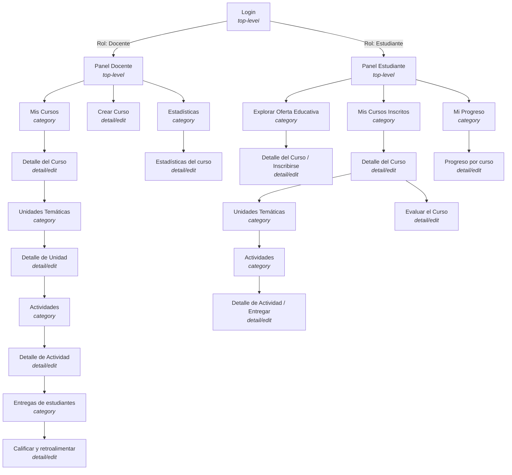

# Cursos Virtuales · Propuesta de navegación (List views and adapters)

Laboratorio de diseño de navegabilidad de **Universidad Piloto de Colombia**, basado en la presentación
*"List views and adapters"* (Gilberto Pedraza García). Aplica los conceptos de **actividad top-level**,
**actividad de categoría (category)** y **actividad de detalle/edición (detail/edit)** al proyecto **Cursos Virtuales**.

## Objetivo

Comprender los mecanismos disponibles para diseñar la navegabilidad de una aplicación Android.

## 1. Preguntas de diseño (diapositiva 8) aplicadas al proyecto

> *"Piensa en una app que te gustaría crear. ¿Qué actividades debería incluir? Organiza esas actividades
> en top-level, category y detail/edit."*

La app es **Cursos Virtuales**: una plataforma de educación virtual con dos roles, **docente** y
**estudiante**, que gestiona oferta educativa, cursos, unidades temáticas, actividades, entregas,
evaluación/retroalimentación, seguimiento de progreso y estadísticas.

**¿Qué actividades debe incluir?**

- Inicio de sesión y selección de rol.
- Para el docente: ver/crear cursos, gestionar unidades y actividades, calificar entregas, ver estadísticas.
- Para el estudiante: explorar la oferta educativa, inscribirse, ver el contenido del curso, entregar
  actividades, evaluar el curso, consultar su propio progreso.

## 2. Propuesta de navegación (estilo diapositiva 9 — "SeCoCo")

Diagrama de árbol: **top-level → category → detail/edit**, igual al ejemplo de la diapositiva 9, pero
con los módulos reales de Cursos Virtuales.

## 3. Clasificación de actividades

| Actividad | Tipo | Navega hacia |
|---|---|---|
| Login | Top-level | Panel Docente / Panel Estudiante (según rol) |
| Panel Docente | Top-level | Mis Cursos, Crear Curso, Estadísticas |
| Panel Estudiante | Top-level | Explorar Oferta, Mis Cursos Inscritos, Mi Progreso |
| Mis Cursos (docente) | Category | Detalle del Curso |
| Explorar Oferta Educativa | Category | Detalle del Curso / Inscribirse |
| Mis Cursos Inscritos | Category | Detalle del Curso |
| Mi Progreso | Category | Progreso por curso |
| Unidades Temáticas | Category | Detalle de Unidad |
| Actividades | Category | Detalle de Actividad |
| Entregas de estudiantes | Category | Calificar y retroalimentar |
| Estadísticas | Category | Estadísticas del curso |
| Crear Curso | Detail/edit | — |
| Detalle del Curso | Detail/edit | Unidades Temáticas, Evaluar el Curso |
| Detalle de Unidad | Detail/edit | Actividades |
| Detalle de Actividad | Detail/edit | Entregas de estudiantes (docente) / Entregar (estudiante) |
| Calificar y retroalimentar | Detail/edit | — |
| Evaluar el Curso | Detail/edit | — |
| Progreso por curso | Detail/edit | — |
| Estadísticas del curso | Detail/edit | — |

## 4. Ejemplo de recorrido (estilo "Starbuzz list of drinks")

Si un **docente** quiere calificar la entrega de un estudiante:

1. Inicia sesión y llega a su **Panel Docente** (top-level).
2. Toca **Mis Cursos** (category) y selecciona un curso → **Detalle del Curso** (detail/edit).
3. Entra a **Unidades Temáticas** (category) → selecciona una unidad → **Actividades** (category).
4. Selecciona una actividad → **Entregas de estudiantes** (category).
5. Toca la entrega de un estudiante → **Calificar y retroalimentar** (detail/edit).

Si un **estudiante** quiere ver su progreso:

1. Inicia sesión y llega a su **Panel Estudiante** (top-level).
2. Toca **Mi Progreso** (category).
3. Selecciona un curso → **Progreso por curso** (detail/edit), con su avance y notas.

## Referencia

Dawn Griffiths and David Griffiths. 2017. *List views and adapters*. In *Head First Android Development*.
O'Reilly Media, Inc. — Presentación de apoyo: Gilberto Pedraza García, Universidad Piloto de Colombia.
